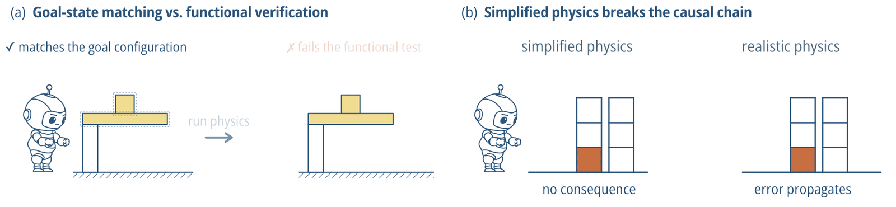

<h1></h1>

[](https://awesome.re)
[](https://neurips.cc/virtual/2026/poster/140116)
[](https://ai4science-westlakeu.github.io/APR/)
[](https://creativecommons.org/licenses/by/4.0/)
[](scripts/LICENSE)
[](CONTRIBUTING.md)

A living audit of agentic physical reasoning (APR) benchmarks, which test LLM agents that act under physics.

Companion to the NeurIPS 2026 position paper *Evaluating Physical Reasoning in LLM Agents Requires Construction Benchmarks* ([project page](https://ai4science-westlakeu.github.io/APR/) · [OpenReview](https://openreview.net/forum?id=42PVaAYxLX)). The paper audits 11 benchmarks against one standard and five capabilities. This repository keeps that audit current after the paper is frozen: new benchmarks are assessed against the same standard and capabilities and added through issues and pull requests.

- **What APR is.** Agentic physical reasoning (APR) is the physical reasoning of LLM agents, an ability rooted in physical intelligence. When an agent acts step by step in a physical environment, physics decides the consequences of each action. The reasoning lies in predicting these consequences and in judging which actions are feasible under physical constraints.
- **What APR is not just.** Solving physics problems on paper, where a model derives an answer to a stated problem and no physical scene responds to its steps. An agent may draw on this skill before designing a complex artifact.
- **Related notions.** See more about how APR relates to neighboring notions of physical intelligence in Appendix B of the paper, which covers intuitive physics ([IntPhys 2](https://arxiv.org/abs/2506.09849), [Physion](https://arxiv.org/abs/2106.08261)) and embodied reasoning ([Cosmos-Reason1](https://arxiv.org/abs/2503.15558)), among others.

## The standard

<p align="center"></p>

An evaluation of physical reasoning must meet two minimum requirements.

1. **Functional verification.** Physics judges the outcome. The artifact the agent produces, such as a structure or a machine, works or it does not.
2. **Realistic physics.** Physical laws, including gravity, friction, and collision, constrain every action along the way.

Together they form one standard. It prescribes no kind of task; in the audit so far, every benchmark that meets it is a construction benchmark, in which the agent builds an artifact. The audit also tracks five capabilities along the agent's loop from goal to verified artifact.

| Capability | Tests whether the agent can |
|---|---|
| **Goal-driven design** (GDD) | generate a solution from a functional specification rather than follow given step-by-step instructions |
| **Physics-aware planning** (PAP) | generate action sequences that obey physical constraints, anticipating how each action affects future states |
| **Embodied execution** (EE) | act in an environment with realistic physics while perceiving the state to inform actions |
| **Functional evaluation** (FE) | anticipate whether an artifact achieves its intended function, beyond receiving post-hoc verification |
| **Closed-loop refinement** (CLR) | receive evaluation signals, detect when goals are not achieved, and adapt upstream decisions |

The five are an initial taxonomy, and this repository is where it evolves.

## Scope

The audit has a fixed scope, the same as the paper's (Section 3.2). A benchmark enters the audit when it meets all three criteria.

1. LLM agents can be evaluated on it and interact with it.
2. Its environment is governed by physical dynamics, from symbolic rules to a rigid-body or richer engine.
3. It provides at least a text or API action interface for perceiving state and issuing commands, regardless of observation modality.

<!-- OUT_OF_SCOPE:START -->
<details>
<summary><b>Out-of-scope examples</b> (not exhaustive)</summary>

Related work outside the scope, grouped by the criterion it misses. Most examples come from Section 3.2 and Appendix B of the paper.

<table>
<thead><tr><th align="left">Example</th><th align="left">Year</th><th align="left">What it evaluates</th></tr></thead>
<tbody>
<tr><td colspan="3"><b>No interactive physics environment</b> · <sub>criterion 1 or 2</sub></td></tr>
<tr><td><a href="https://arxiv.org/abs/2605.10820">MaD Physics</a></td><td>2026</td><td>Choosing measurements of simulated physical systems that the agent cannot act on, scored by predictions of later states</td></tr>
<tr><td><a href="https://arxiv.org/abs/2609.01552">SciLaws-Bench</a></td><td>2026</td><td>Scientific law discovery from fixed data or from queries to a simulator that returns a hidden formula plus noise</td></tr>
<tr><td><a href="https://arxiv.org/abs/2503.15558">Cosmos-Reason1</a></td><td>2025</td><td>Yes-or-no and multiple-choice questions about videos of robots and driving</td></tr>
<tr><td><a href="https://openreview.net/forum?id=Wmsnx7EPel">EngDesign</a></td><td>2025</td><td>Engineering design answers, scored by task scripts that sometimes run domain simulators</td></tr>
<tr><td><a href="https://arxiv.org/abs/2506.09849">IntPhys 2</a></td><td>2025</td><td>Judging whether videos are physically possible</td></tr>
<tr><td><a href="https://doi.org/10.52202/085713-0044">PHYBench</a></td><td>2025</td><td>Physics problem solving, scored against reference answers</td></tr>
<tr><td><a href="https://openreview.net/forum?id=z6WfQ43sHr">PhyBlock</a></td><td>2025</td><td>Block assembly plans, scored against annotations and never executed in a simulator</td></tr>
<tr><td><a href="https://arxiv.org/abs/2505.15929">PhyX</a></td><td>2025</td><td>Physics problem solving with images, scored against reference answers</td></tr>
<tr><td><a href="https://doi.org/10.18653/v1/2025.acl-long.811">PhysReason</a></td><td>2025</td><td>Physics problem solving, scored against reference answers and solution steps</td></tr>
<tr><td><a href="https://doi.org/10.1109/wacv61042.2026.00099">Physics-IQ</a></td><td>2025</td><td>Video continuations from generative models, compared with real recordings</td></tr>
<tr><td><a href="https://doi.org/10.1109/iccv51701.2025.00533">STI-Bench</a></td><td>2025</td><td>Spatiotemporal question answering over videos</td></tr>
<tr><td><a href="https://openreview.net/forum?id=EmLiyZGvrR">UGPhysics</a></td><td>2025</td><td>Undergraduate physics problem solving, scored against reference answers</td></tr>
<tr><td><a href="https://doi.org/10.1109/iccv51701.2025.00651">3DSRBench</a></td><td>2024</td><td>3D spatial question answering over images</td></tr>
<tr><td><a href="https://openreview.net/forum?id=tN61DTr4Ed">OSWorld</a></td><td>2024</td><td>Tasks in real computer environments</td></tr>
<tr><td><a href="https://openreview.net/forum?id=DW8U8ZWa1U">SAT</a></td><td>2024</td><td>Spatial question answering on simulated scenes</td></tr>
<tr><td><a href="https://doi.org/10.1109/cvpr52734.2025.00994">VSI-Bench</a></td><td>2024</td><td>Spatial question answering over videos</td></tr>
<tr><td><a href="https://openreview.net/forum?id=zAdUB0aCTQ">AgentBench</a></td><td>2023</td><td>LLM agents across software, game, and web environments</td></tr>
<tr><td><a href="https://openreview.net/forum?id=fibxvahvs3">GAIA</a></td><td>2023</td><td>Questions for general AI assistants</td></tr>
<tr><td><a href="https://doi.org/10.24963/ijcai.2024/696">GRASP</a></td><td>2023</td><td>Language grounding and situated physics understanding in videos</td></tr>
<tr><td><a href="https://openreview.net/forum?id=5Exz7eaBXH">Physion++</a></td><td>2023</td><td>Inferring physical properties from videos</td></tr>
<tr><td><a href="https://openreview.net/forum?id=VTF8yNQM66">SWE-bench</a></td><td>2023</td><td>Resolving GitHub issues</td></tr>
<tr><td><a href="https://openreview.net/forum?id=dHng2O0Jjr">ToolBench</a></td><td>2023</td><td>Using real-world APIs</td></tr>
<tr><td><a href="https://openreview.net/forum?id=oKn9c6ytLx">WebArena</a></td><td>2023</td><td>Tasks on websites</td></tr>
<tr><td><a href="https://openreview.net/forum?id=PgNEYaIc81Q">ComPhy</a></td><td>2022</td><td>Compositional physical reasoning about objects and events in videos</td></tr>
<tr><td><a href="https://openreview.net/forum?id=CXyZrKPz4CU">Physion</a></td><td>2021</td><td>Predicting physical outcomes from videos</td></tr>
<tr><td><a href="https://doi.org/10.1109/cvpr.2017.215">CLEVR</a></td><td>2016</td><td>Visual question answering on rendered scenes</td></tr>
<tr><td colspan="3"><b>No text-based interaction interface</b> · <sub>criterion 3</sub></td></tr>
<tr><td><a href="https://doi.org/10.15607/rss.2024.xx.061">HumanoidBench</a></td><td>2024</td><td>Whole-body humanoid locomotion and manipulation</td></tr>
<tr><td><a href="https://doi.org/10.1177/02783649241304789">FurnitureBench</a></td><td>2023</td><td>Long-horizon furniture assembly by a robot arm</td></tr>
<tr><td><a href="https://doi.org/10.1109/lra.2023.3330611">RAMP</a></td><td>2023</td><td>Robotic assembly manipulation and planning</td></tr>
<tr><td><a href="https://doi.org/10.1007/978-3-031-19815-1_6">Break and Make</a></td><td>2022</td><td>Interactive structural understanding with LEGO bricks</td></tr>
<tr><td><a href="https://proceedings.mlr.press/v155/lin21a.html">SoftGym</a></td><td>2020</td><td>Deformable object manipulation</td></tr>
<tr><td><a href="https://doi.org/10.1109/icra48506.2021.9560986">IKEA Furniture Assembly</a></td><td>2019</td><td>Long-horizon furniture assembly in simulation</td></tr>
<tr><td><a href="https://proceedings.mlr.press/v100/yu20a.html">Meta-World</a></td><td>2019</td><td>Multi-task and meta reinforcement learning on tabletop manipulation</td></tr>
<tr><td><a href="https://proceedings.neurips.cc/paper_files/paper/2019/file/4191ef5f6c1576762869ac49281130c9-Paper.pdf">PHYRE</a></td><td>2019</td><td>2D physics puzzles solved by placing balls, one continuous action vector per attempt for learning agents</td></tr>
<tr><td><a href="https://arxiv.org/abs/1801.00690">DeepMind Control Suite</a></td><td>2018</td><td>Continuous control tasks</td></tr>
<tr><td><a href="https://proceedings.mlr.press/v78/dosovitskiy17a.html">CARLA</a></td><td>2017</td><td>Urban driving</td></tr>
<tr><td colspan="3"><b>Not evaluation suites</b> · <sub>methods and generators</sub></td></tr>
<tr><td><a href="https://doi.org/10.1109/iccv51701.2025.01373">BrickGPT</a></td><td>2025</td><td>Generating physically stable and buildable brick structures from text</td></tr>
<tr><td><a href="https://doi.org/10.1109/icra55743.2025.11128440">MatchMaker</a></td><td>2025</td><td>Automated asset generation for robotic assembly</td></tr>
<tr><td><a href="https://openreview.net/forum?id=SQIDlJd3hN">RoboGen</a></td><td>2023</td><td>Generative simulation of tasks and data for robot learning</td></tr>
<tr><td><a href="https://doi.org/10.1145/3550454.3555525">Assemble Them All</a></td><td>2022</td><td>Physics-based assembly planning by disassembly</td></tr>
</tbody>
</table>

</details>
<!-- OUT_OF_SCOPE:END -->

## Audit

How to read the tables:

- **Class** names the task. Construction and Embodied need a realistic engine for at least part of the benchmark, and the Physics column says how much. A suite that mixes kinds of task takes the class of most of its tasks.
  - **Symbolic-Physical**: symbolic state
  - **Simplified Sandbox**: simplified physics
  - **Construction**: building artifacts
  - **Embodied**: acting toward goals or answers
- **Capabilities**: the five above.
  - ✓ tested
  - ✗ not tested
  - ◐ tested in some tasks or in a weaker form
  - ? unclear from the published text
- **Physics**
  - `symbolic`: rule-based state
  - `simplified`: gravity, friction, or collision left out
  - `realistic`: a rigid-body or richer engine, 2D included
  - `partial`: physics in only some tasks or some checks
- **Evaluation**
  - `functional`: physics tests the function
  - `goal-state`: final state against goal conditions
  - `answer`: answers against reference answers
  - `judge`: a model or a human scores the result
  - `mixed`: more than one of these
- **Both**: the two minimum requirements together. The class does not decide it, so a construction benchmark can still miss it.
  - ◐ physics checks only part of the result
- **Names** link to the papers. The small text gives the year of first release and a code link where public code exists.

<!-- AUDIT:START -->
**In the paper** (Table 2, 11 benchmarks, 2 meet both requirements). Assessed in January 2026; BuildArena re-assessed in October 2026.

<table>
<thead><tr><th align="left">Benchmark</th><th align="center">GDD</th><th align="center">PAP</th><th align="center">EE</th><th align="center">FE</th><th align="center">CLR</th><th align="left">Physics</th><th align="left">Evaluation</th><th align="center">Both</th></tr></thead>
<tbody>
<tr><td colspan="9"><b>Construction</b> · <sub>realistic physics, building artifacts</sub></td></tr>
<tr><td><a href="https://arxiv.org/abs/2510.14980">BesiegeField</a> <sub>2025 · <a href="https://github.com/Godheritage/BesiegeField">code</a></sub></td><td align="center">✓</td><td align="center">✓</td><td align="center">✗</td><td align="center">✓</td><td align="center">✓</td><td>realistic</td><td>functional</td><td align="center">✓</td></tr>
<tr><td><a href="https://arxiv.org/abs/2510.16559">BuildArena</a> <sub>2025 · <a href="https://github.com/AI4Science-WestlakeU/BuildArena">code</a></sub></td><td align="center">✓</td><td align="center">✓</td><td align="center">✗</td><td align="center">✓</td><td align="center">✓</td><td>realistic</td><td>functional</td><td align="center">✓</td></tr>
<tr><td colspan="9"><b>Embodied</b> · <sub>realistic physics, acting toward goals</sub></td></tr>
<tr><td><a href="https://arxiv.org/abs/2502.09560">EmbodiedBench</a> <sub>2025 · <a href="https://github.com/EmbodiedBench/EmbodiedBench">code</a></sub></td><td align="center">✗</td><td align="center">✗</td><td align="center">✓</td><td align="center">✗</td><td align="center">✗</td><td>realistic</td><td>goal-state</td><td align="center">✗</td></tr>
<tr><td><a href="https://arxiv.org/abs/2411.00081">PARTNR</a> <sub>2024 · <a href="https://github.com/facebookresearch/partnr-planner">code</a></sub></td><td align="center">✗</td><td align="center">✗</td><td align="center">✓</td><td align="center">✗</td><td align="center">✗</td><td>realistic</td><td>goal-state</td><td align="center">✗</td></tr>
<tr><td colspan="9"><b>Simplified Sandbox</b> · <sub>simplified physics</sub></td></tr>
<tr><td><a href="https://arxiv.org/abs/2505.20148">MineAnyBuild</a> <sub>2025 · <a href="https://github.com/MineAnyBuild/MineAnyBuild">code</a></sub></td><td align="center">✓</td><td align="center">✗</td><td align="center">✗</td><td align="center">✗</td><td align="center">✗</td><td>simplified</td><td>goal-state</td><td align="center">✗</td></tr>
<tr><td><a href="https://arxiv.org/abs/2407.12734">Minecraft Builder Dialog</a> <sub>2024</sub></td><td align="center">✓</td><td align="center">✗</td><td align="center">✗</td><td align="center">✗</td><td align="center">✗</td><td>simplified</td><td>goal-state</td><td align="center">✗</td></tr>
<tr><td><a href="https://arxiv.org/abs/2412.21033">Plancraft</a> <sub>2024 · <a href="https://github.com/gautierdag/plancraft">code</a></sub></td><td align="center">✗</td><td align="center">✗</td><td align="center">✗</td><td align="center">✗</td><td align="center">✓</td><td>simplified</td><td>goal-state</td><td align="center">✗</td></tr>
<tr><td><a href="https://arxiv.org/abs/2412.05255">TeamCraft</a> <sub>2024 · <a href="https://github.com/teamcraft-bench/teamcraft">code</a></sub></td><td align="center">✓</td><td align="center">✗</td><td align="center">✗</td><td align="center">✗</td><td align="center">✗</td><td>simplified</td><td>goal-state</td><td align="center">✗</td></tr>
<tr><td><a href="https://arxiv.org/abs/2206.08853">MineDojo</a> <sub>2022 · <a href="https://github.com/MineDojo/MineDojo">code</a></sub></td><td align="center">✗</td><td align="center">✗</td><td align="center">✗</td><td align="center">✗</td><td align="center">✓</td><td>simplified</td><td>goal-state</td><td align="center">✗</td></tr>
<tr><td colspan="9"><b>Symbolic-Physical</b> · <sub>symbolic state</sub></td></tr>
<tr><td><a href="https://arxiv.org/abs/2203.07540">ScienceWorld</a> <sub>2022 · <a href="https://github.com/allenai/ScienceWorld">code</a></sub></td><td align="center">✗</td><td align="center">✓</td><td align="center">✗</td><td align="center">✗</td><td align="center">✗</td><td>symbolic</td><td>goal-state</td><td align="center">✗</td></tr>
<tr><td><a href="https://arxiv.org/abs/2010.03768">ALFWorld</a> <sub>2020 · <a href="https://github.com/alfworld/alfworld">code</a></sub></td><td align="center">✗</td><td align="center">✗</td><td align="center">✗</td><td align="center">✗</td><td align="center">✗</td><td>symbolic</td><td>goal-state</td><td align="center">✗</td></tr>
</tbody>
</table>

**Candidates** (30). Assessed from the published texts, pending review by the paper's authors. The evidence for each judgment is in `data/benchmarks.yaml`.

<table>
<thead><tr><th align="left">Benchmark</th><th align="center">GDD</th><th align="center">PAP</th><th align="center">EE</th><th align="center">FE</th><th align="center">CLR</th><th align="left">Physics</th><th align="left">Evaluation</th><th align="center">Both</th></tr></thead>
<tbody>
<tr><td colspan="9"><b>Construction</b> · <sub>realistic physics, building artifacts</sub></td></tr>
<tr><td><a href="https://arxiv.org/abs/2610.06511">ArtifactArena</a> <sub>2026 · <a href="https://github.com/ArtifactArena/harness-public">code</a></sub></td><td align="center">✓</td><td align="center">✓</td><td align="center">✗</td><td align="center">✓</td><td align="center">✓</td><td>realistic</td><td>functional</td><td align="center">✓</td></tr>
<tr><td><a href="https://arxiv.org/abs/2610.12452">BrickBench</a> <sub>2026 · <a href="https://github.com/kulits/BrickAgent">code</a></sub></td><td align="center">✓</td><td align="center">✗</td><td align="center">✗</td><td align="center">◐</td><td align="center">✓</td><td>partial</td><td>mixed</td><td align="center">◐</td></tr>
<tr><td><a href="https://arxiv.org/abs/2610.26861">FunCADBench</a> <sub>2026 · <a href="https://github.com/thegenlab/fun-CAD-harness">code</a></sub></td><td align="center">✓</td><td align="center">◐</td><td align="center">✗</td><td align="center">✓</td><td align="center">✓</td><td>realistic</td><td>functional</td><td align="center">✓</td></tr>
<tr><td><a href="https://arxiv.org/abs/2610.04292">LMBuild</a> <sub>2026 · <a href="https://github.com/Lumos-Jiateng/LMBuild">code</a></sub></td><td align="center">✓</td><td align="center">◐</td><td align="center">✗</td><td align="center">◐</td><td align="center">✓</td><td>partial</td><td>mixed</td><td align="center">◐</td></tr>
<tr><td><a href="https://arxiv.org/abs/2608.14441">PACE-Bench</a> <sub>2026 · <a href="https://github.com/thunlp/PACE-Bench">code</a></sub></td><td align="center">✓</td><td align="center">✓</td><td align="center">✗</td><td align="center">✓</td><td align="center">✓</td><td>realistic</td><td>functional</td><td align="center">✓</td></tr>
<tr><td><a href="https://arxiv.org/abs/2609.21493">PolyBridgeBench</a> <sub>2026</sub></td><td align="center">✓</td><td align="center">✗</td><td align="center">✗</td><td align="center">✓</td><td align="center">✓</td><td>realistic</td><td>functional</td><td align="center">✓</td></tr>
<tr><td colspan="9"><b>Embodied</b> · <sub>realistic physics, acting toward goals</sub></td></tr>
<tr><td><a href="https://arxiv.org/abs/2603.22435">CaP-X</a> <sub>2026 · <a href="https://github.com/capgym/cap-x">code</a></sub></td><td align="center">✗</td><td align="center">◐</td><td align="center">◐</td><td align="center">✗</td><td align="center">✓</td><td>realistic</td><td>goal-state</td><td align="center">✗</td></tr>
<tr><td><a href="https://arxiv.org/abs/2609.33807">CodeActionBench</a> <sub>2026 · <a href="https://github.com/lyhkk/CodeActionBench">code</a></sub></td><td align="center">✗</td><td align="center">◐</td><td align="center">✓</td><td align="center">✗</td><td align="center">✓</td><td>realistic</td><td>goal-state</td><td align="center">✗</td></tr>
<tr><td><a href="https://arxiv.org/abs/2605.18746">ESI-Bench</a> <sub>2026 · <a href="https://github.com/ESI-Bench/ESI-Bench">code</a></sub></td><td align="center">✗</td><td align="center">◐</td><td align="center">✓</td><td align="center">✗</td><td align="center">✗</td><td>realistic</td><td>answer</td><td align="center">✗</td></tr>
<tr><td><a href="https://arxiv.org/abs/2603.13033">ESPIRE</a> <sub>2026 · <a href="https://github.com/spatigen/espire">code</a></sub></td><td align="center">✗</td><td align="center">✗</td><td align="center">✓</td><td align="center">✗</td><td align="center">◐</td><td>realistic</td><td>goal-state</td><td align="center">✗</td></tr>
<tr><td><a href="https://arxiv.org/abs/2610.00854">Embodied Agent Arena</a> <sub>2026 · <a href="https://github.com/embodied-agent-arena/embodied-agent-arena">code</a></sub></td><td align="center">✗</td><td align="center">◐</td><td align="center">✓</td><td align="center">✗</td><td align="center">✗</td><td>realistic</td><td>goal-state</td><td align="center">✗</td></tr>
<tr><td><a href="https://arxiv.org/abs/2610.27039">Embodied Playground</a> <sub>2026 · <a href="https://github.com/Winniechen2002/Embodied-Playground">code</a></sub></td><td align="center">◐</td><td align="center">✓</td><td align="center">✓</td><td align="center">◐</td><td align="center">◐</td><td>realistic</td><td>mixed</td><td align="center">◐</td></tr>
<tr><td><a href="https://arxiv.org/abs/2609.28236">EmbodiedMemory-Bench</a> <sub>2026 · <a href="https://github.com/ZJU-OmniAI/Embodied-Omni/tree/main/embodied_memory">code</a></sub></td><td align="center">✗</td><td align="center">✗</td><td align="center">✓</td><td align="center">✗</td><td align="center">✗</td><td>realistic</td><td>goal-state</td><td align="center">✗</td></tr>
<tr><td><a href="https://arxiv.org/abs/2607.02440">EvoPolicyGym</a> <sub>2026 · <a href="https://github.com/Linzwcs/EvoPolicyGym">code</a></sub></td><td align="center">✗</td><td align="center">◐</td><td align="center">✗</td><td align="center">✗</td><td align="center">✓</td><td>partial</td><td>mixed</td><td align="center">✗</td></tr>
<tr><td><a href="https://arxiv.org/abs/2607.27180">HumanCLAW-Bench</a> <sub>2026 · <a href="https://github.com/Human-CLAW/HumanCLAW">code</a></sub></td><td align="center">✗</td><td align="center">✗</td><td align="center">✓</td><td align="center">✗</td><td align="center">✗</td><td>realistic</td><td>goal-state</td><td align="center">✗</td></tr>
<tr><td><a href="https://arxiv.org/abs/2609.39507">LIBERO-Agent</a> <sub>2026 · <a href="https://github.com/dzj441/Libero-Agent">code</a></sub></td><td align="center">✗</td><td align="center">◐</td><td align="center">✓</td><td align="center">✗</td><td align="center">◐</td><td>realistic</td><td>goal-state</td><td align="center">✗</td></tr>
<tr><td><a href="https://arxiv.org/abs/2609.13152">PhysMent</a> <sub>2026 · <a href="https://github.com/DRJCompSciWiz/PhysMent---An-Interactive-Approach-For-LLM-Reasoning-In-Physics-Problems">code</a></sub></td><td align="center">✗</td><td align="center">◐</td><td align="center">✓</td><td align="center">✗</td><td align="center">✗</td><td>realistic</td><td>answer</td><td align="center">✗</td></tr>
<tr><td><a href="https://arxiv.org/abs/2609.34210">RLE-Bench</a><sup>[1]</sup> <sub>2026 · <a href="https://github.com/RLE-Bench/RLE-Bench">code</a></sub></td><td align="center">◐</td><td align="center">◐</td><td align="center">◐</td><td align="center">◐</td><td align="center">✓</td><td>realistic</td><td>mixed</td><td align="center">◐</td></tr>
<tr><td><a href="https://arxiv.org/abs/2609.10895">ReactHuman</a> <sub>2026</sub></td><td align="center">✗</td><td align="center">◐</td><td align="center">✗</td><td align="center">✗</td><td align="center">✗</td><td>realistic</td><td>answer</td><td align="center">✗</td></tr>
<tr><td><a href="https://arxiv.org/abs/2609.24170">RoboDojo + RoboProbe</a> <sub>2026 · <a href="https://github.com/RoboProbe/RoboProbe">code</a></sub></td><td align="center">✗</td><td align="center">◐</td><td align="center">✓</td><td align="center">✗</td><td align="center">✗</td><td>realistic</td><td>goal-state</td><td align="center">✗</td></tr>
<tr><td><a href="https://arxiv.org/abs/2610.10388">RoboQuest</a> <sub>2026 · <a href="https://github.com/declare-lab/RoboQuest">code</a></sub></td><td align="center">✗</td><td align="center">◐</td><td align="center">✓</td><td align="center">✗</td><td align="center">◐</td><td>realistic</td><td>goal-state</td><td align="center">✗</td></tr>
<tr><td><a href="https://arxiv.org/abs/2606.09669">SpatialWorld</a> <sub>2026 · <a href="https://github.com/Hongcheng-Gao/SpatialWorld">code</a></sub></td><td align="center">✗</td><td align="center">✗</td><td align="center">✓</td><td align="center">✗</td><td align="center">✗</td><td>realistic</td><td>goal-state</td><td align="center">✗</td></tr>
<tr><td><a href="https://arxiv.org/abs/2609.19554">VABench</a> <sub>2026 · <a href="https://github.com/zhangzhongbo2213/VABench">code</a></sub></td><td align="center">✗</td><td align="center">◐</td><td align="center">✓</td><td align="center">✗</td><td align="center">◐</td><td>realistic</td><td>goal-state</td><td align="center">✗</td></tr>
<tr><td><a href="https://arxiv.org/abs/2508.05405">DeepPHY</a> <sub>2025 · <a href="https://github.com/XinrunXu/DeepPHY">code</a></sub></td><td align="center">✗</td><td align="center">✓</td><td align="center">✓</td><td align="center">✗</td><td align="center">✓</td><td>realistic</td><td>goal-state</td><td align="center">✗</td></tr>
<tr><td colspan="9"><b>Simplified Sandbox</b> · <sub>simplified physics</sub></td></tr>
<tr><td><a href="https://arxiv.org/abs/2605.26087">DiscoverPhysics</a> <sub>2026 · <a href="https://github.com/SampsonML/DiscoverPhysics">code</a></sub></td><td align="center">✗</td><td align="center">✗</td><td align="center">✗</td><td align="center">✗</td><td align="center">✓</td><td>simplified</td><td>mixed</td><td align="center">✗</td></tr>
<tr><td><a href="https://arxiv.org/abs/2610.11328">Mine Odyssey</a> <sub>2026 · <a href="https://github.com/hkust-nlp/MineOdyssey">code</a></sub></td><td align="center">✗</td><td align="center">✗</td><td align="center">✗</td><td align="center">✗</td><td align="center">✓</td><td>simplified</td><td>goal-state</td><td align="center">✗</td></tr>
<tr><td><a href="https://arxiv.org/abs/2608.28884">MineCEraft</a> <sub>2026 · <a href="https://github.com/SewoongLee/mineCEraft">code</a></sub></td><td align="center">✓</td><td align="center">◐</td><td align="center">✗</td><td align="center">◐</td><td align="center">✗</td><td>simplified</td><td>mixed</td><td align="center">✗</td></tr>
<tr><td><a href="https://arxiv.org/abs/2605.30931">MineExplorer</a> <sub>2026 · <a href="https://github.com/meituan-longcat/MineExplorer">code</a></sub></td><td align="center">✗</td><td align="center">✗</td><td align="center">✗</td><td align="center">✗</td><td align="center">✗</td><td>simplified</td><td>goal-state</td><td align="center">✗</td></tr>
<tr><td><a href="https://arxiv.org/abs/2605.11223">VLATIM</a> <sub>2026 · <a href="https://github.com/Marco2929/FMVLATIMBench">code</a></sub></td><td align="center">◐</td><td align="center">✗</td><td align="center">✗</td><td align="center">✗</td><td align="center">✗</td><td>simplified</td><td>mixed</td><td align="center">✗</td></tr>
<tr><td colspan="9"><b>Symbolic-Physical</b> · <sub>symbolic state</sub></td></tr>
<tr><td><a href="https://arxiv.org/abs/2606.31966">MECoBench</a> <sub>2026 · <a href="https://github.com/q-i-n-g/MECoBench">code</a></sub></td><td align="center">✗</td><td align="center">✗</td><td align="center">✗</td><td align="center">✗</td><td align="center">◐</td><td>symbolic</td><td>goal-state</td><td align="center">✗</td></tr>
</tbody>
</table>

<details>
<summary><sub>Notes (1)</sub></summary>

<sub>[1] RLE-Bench mixes task forms and takes the class of most of its 51 tasks, which are robot control, policy development, and perception. Four of its tasks are construction scored by physics in simulation. In them the agent builds a tower and a cantilever with a robot arm, designs a mobile base, and designs gravity compensation for a leader arm.</sub>

</details>
<!-- AUDIT:END -->

## Add a benchmark

Open an issue with the [*New benchmark*](../../issues/new?template=new-benchmark.yml) template, or send a pull request that adds a record to [`data/benchmarks.yaml`](data/benchmarks.yaml), or an out-of-scope example to [`data/out_of_scope.yaml`](data/out_of_scope.yaml), and runs `python3 scripts/build_readme.py`. New records enter as candidates and move to the audited tables once the paper's authors review the evidence. [CONTRIBUTING.md](CONTRIBUTING.md) lists the fields and the conventions for each judgment.

## Changelog

- 2026-11-05 · 24 candidates added, three of them released before the paper's submission but not in its audit (DeepPHY, ESPIRE, CaP-X). Out-of-scope examples listed under Scope. Classes follow physics and task.
- 2026-10-14 · Six candidates assessed from texts released after the paper's audit (ArtifactArena, PACE-Bench, PolyBridgeBench, RLE-Bench, LMBuild, BrickBench). BuildArena re-assessed on its later version, whose optional closed-loop protocol tests closed-loop refinement.
- 2026-01-29 · Initial audit: the 11 benchmarks of Table 2 in the paper.

## Citation

```bibtex
@inproceedings{deng2026construction,
  title     = {Evaluating Physical Reasoning in {LLM} Agents Requires Construction Benchmarks},
  author    = {Deng, Wenhao and Xia, Tian and Jiang, Yuru and Jose, Joemon M. and Wu, Tailin},
  booktitle = {Advances in Neural Information Processing Systems (NeurIPS), Position Paper Track},
  year      = {2026}
}
```

## License

The audit data and text are released under [CC BY 4.0](https://creativecommons.org/licenses/by/4.0/). The scripts are released under the MIT License (see [`scripts/LICENSE`](scripts/LICENSE)).
